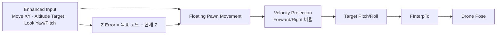

<iframe src="https://www.youtube-nocookie.com/embed/3lsftCbEYQE" title="드론 비행" loading="lazy" style="width:100%;aspect-ratio:16/9;border:0;border-radius:12px" allow="accelerometer; clipboard-write; encrypted-media; gyroscope; picture-in-picture" allowfullscreen></iframe>

Enhanced Input에서 평면 이동, 고도, 시점 입력을 분리합니다. 목표 고도와 현재 Z의 오차를 추력으로 바꾸고, 속도를 기체 Forward/Right 축에 투영해 목표 Pitch/Roll을 계산합니다.

```text
ZError = TargetAltitude - CurrentZ
ZThrust = Clamp(ZError / 200, -1, 1)

ForwardRatio = Dot(Velocity, Forward) / MaxSpeed
RightRatio   = Dot(Velocity, Right) / MaxSpeed

TargetPitch = -ForwardRatio × MaxTiltAngle
TargetRoll  =  RightRatio × MaxTiltAngle
```

최종 자세는 `FInterpTo`로 보간하고, 지면과 가까울수록 최대 기울기를 축소합니다.



이 구현은 X/Y/Z 이동과 Pitch/Yaw/Roll 표현으로 6DOF에 가까운 비행 감각을 제공합니다. 다만 Roll은 독립 입력이 아니라 횡이동 속도에서 파생되므로 "완전 독립 6축 물리 시뮬레이션"이 아니라 <strong>"6DOF 스타일 자유 비행"</strong>으로 표현합니다.

| 결정 | 선택 | 이유 |
| --- | --- | --- |
| 이동 축 | Enhanced Input에서 XY/고도/시점 분리 | 입력 책임을 명확히 나눠 조작 로직 단순화 |
| 자세(Pitch/Roll) | 속도를 Forward/Right에 투영해 파생 | 독립 6축 물리 없이도 관성감 있는 기울임 표현 |
| 고도 제어 | 목표-현재 Z 오차 → Clamp된 추력 | 과도한 진동 없이 부드러운 고도 수렴 |
