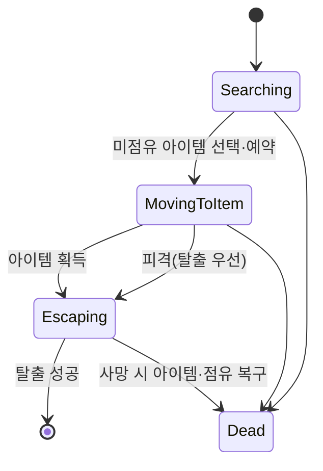

`Searching → MovingToItem → Escaping → Dead` 흐름을 `IEnemyInterface`로 공유합니다. 가장 가까운 미점유 아이템을 고른 즉시 `bIsTaken`을 설정해 다른 적의 중복 선택을 방지합니다.



```cpp
// 가장 가까운 미점유 아이템 선택과 동시에 예약
if (AItem* Best = FindNearestUnclaimedItem())
{
    Best->bIsTaken = true;   // 다른 적의 중복 선택 방지
    CurrentTarget = Best;
    SetState(EEnemyState::MovingToItem);
}
```

---
## 인간형 적

`FAIMoveRequest`와 NavMesh 경로 탐색을 쓰되 Partial Path는 허용하지 않아 도달 불가능한 목표에 집착하지 않습니다. RVO Avoidance로 캐릭터 간 국소 회피를 하고, Overlap 누락에 대비해 2D 거리 도착 판정을 추가로 둡니다. 피격 시에는 탈취보다 탈출을 우선하도록 상태를 전환합니다.

---
## 적 드론

가장 가까운 아이템으로 공중 이동해 획득 시 기체에 부착하고 물리·충돌을 비활성화합니다. 운반 중에는 최대 속도 60%, 가속도 40%로 감소시키고 최대 기울기·보간 속도를 낮춰 무게감을 표현합니다. 사망 시 같은 아이템 클래스를 현재 위치에 재생성하고 상태를 복구합니다.

---
## 대칭 정리

적이 사망하거나 목표가 무효화되면 점유 플래그, 가시성, 충돌, 물리, Overlap을 모두 복구해야 합니다. 획득과 해제 로직을 대칭적으로 구성해 런타임 상태 누수를 막았습니다.

| 결정 | 선택 | 이유 |
| --- | --- | --- |
| 상태 공유 | IEnemyInterface 공통 상태 흐름 | 인간형·드론이 같은 규칙으로 아이템 경쟁 |
| 아이템 경쟁 | 선택 즉시 bIsTaken 예약 | 다수 AI의 동일 목표 중복 선택 방지 |
| 정리 로직 | 획득/해제를 대칭 구성 | 사망·무효화 시 상태 누수 방지 |
