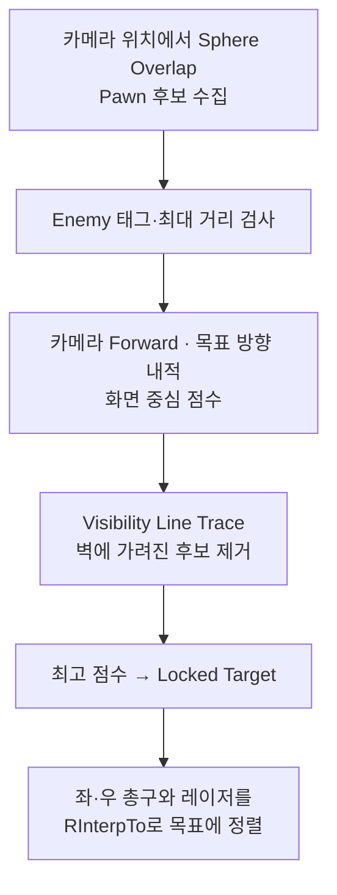

<iframe src="https://www.youtube-nocookie.com/embed/R7lcIM-zAII" title="락온과 공격 시퀀스" loading="lazy" style="width:100%;aspect-ratio:16/9;border:0;border-radius:12px" allow="accelerometer; clipboard-write; encrypted-media; gyroscope; picture-in-picture" allowfullscreen></iframe>

넓은 범위에서 적을 찾는 탐색과, 실제로 조준 가능한지 가려내는 정밀 판정을 한 번에 처리하면 매 프레임 비싼 라인 트레이스를 모든 후보에 날리게 됩니다.

## 락온 파이프라인



Overlap은 broad phase, 내적과 Trace는 narrow phase 역할을 하며, 탐색은 조준 중 0.1초 타이머로만 실행해 비용을 제어합니다.

```cpp
// broad phase: Sphere Overlap + 태그/거리 필터
// narrow phase: 카메라 forward · 목표 방향 내적으로 화면 중심 점수, Visibility Trace로 은폐 후보 제거
float Score = FVector::DotProduct(CameraForward, ToTarget.GetSafeNormal());
if (bHasLineOfSight && Score > BestScore) { BestScore = Score; LockedTarget = Candidate; }
```

## 공격 시퀀스

2.5초 준비 후 0.15초 간격으로 좌우 총구를 교대하며 8회 실행, 0.7초 간격을 두고 다시 8회를 실행해 총 16회를 쏩니다. 활성 타이머 검사로 중복 입력을 차단하고, 레이저는 Visibility Trace의 실제 충돌 거리만큼 길이를 조절합니다.

| 결정 | 선택 | 이유 |
| --- | --- | --- |
| 탐색 구조 | Overlap(broad) + 내적/Trace(narrow) 분리 | 매 프레임 전체 후보에 Trace를 날리지 않아도 됨 |
| 우선순위 | 화면 중심 내적 점수 | 플레이어가 보고 있는 적을 우선 락온 |
| 공격 시퀀스 | 타이머 기반 8+8 이중 펄스 | 중복 입력 차단과 일정한 리듬의 연사 표현 |
