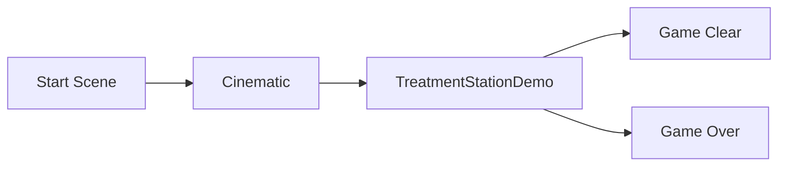

<iframe src="https://www.youtube-nocookie.com/embed/thvEaP8ac-E" title="라운드 진행과 HUD" loading="lazy" style="width:100%;aspect-ratio:16/9;border:0;border-radius:12px" allow="accelerometer; clipboard-write; encrypted-media; gyroscope; picture-in-picture" allowfullscreen></iframe>

GameState가 상자·적·시간·점수를 통합 관리하고, GameInstance와 UMG를 연결해 3단계 난이도, 적 재스폰, 누적 점수, Ghost HP를 하나의 라운드 루프로 구현했습니다.

---
## 난이도 곡선

| 단계 | 상자 | 적 드론 비율 |
| --- | --- | --- |
| 1 | 3 | 0% |
| 2 | 5 | 30% |
| 3 | 7 | 50% |

현재 적 수는 남은 상자 수와 연동합니다. 적이 제거되거나 탈출해 수가 부족해지면 3초 뒤 새로운 적을 생성합니다. 레벨 종료 시 남은 상자의 가치를 점수에 합산하고, 누적 점수는 GameInstance에 저장합니다.

---
## HUD

HUD는 Score, Level, Remaining Time을 실시간 표시하고, 실제 HP와 늦게 따라오는 Ghost HP를 분리해 피격 임팩트를 표현합니다. 시스템 메시지는 Queue에 저장해 0.05초 타자 효과와 메시지 간 3초 대기로 순차 재생합니다.

---
## 레벨 전환

Fade와 Timer로 화면 전환 타이밍을 동기화합니다.

| 결정 | 선택 | 이유 |
| --- | --- | --- |
| 난이도 곡선 | 단계별 상자 수 + 적 드론 비율 증가 | 단순한 숫자 튜닝만으로 웨이브 난이도 조절 |
| 체력 표현 | 실제 HP + 지연되는 Ghost HP | 피격 순간의 데미지 크기를 시각적으로 강조 |
| 메시지 | Queue + 타자 효과 | 여러 이벤트가 겹쳐도 순차적으로 읽히게 함 |
