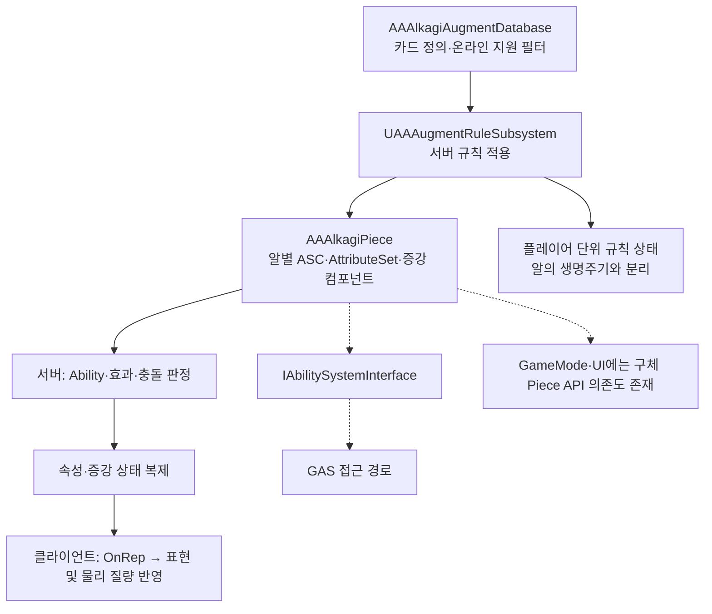

## 요구사항

변신·빙결·질량처럼 <strong>알마다 달라야 하는 상태</strong>는 개별 말(Piece)에 둡니다. 반면 육중함·정밀 조준처럼 새 알에도 상속할 지속 규칙은 `UAAAugmentRuleSubsystem`의 플레이어별 규칙 집합에 보관합니다. 따라서 GAS의 소유 단위는 PlayerState나 Character가 아닌 개별 알로 두고, 알별 상태와 플레이어 단위 규칙을 나눴습니다.

---
## 왜 이 기술을 선택했나

GAS 예제 대부분은 `ACharacter` 기준이지만, 이 게임의 말은 CharacterMovement가 아니라 <strong>Chaos 물리로 굴러가는 `AActor`</strong>다. 그래서 Character 없이 Actor가 ASC를 직접 소유하는 구조를 택했습니다. 물리 게임이므로 어트리뷰트도 HP/Mana가 아니라 <strong>물리 파라미터</strong>로 정의했습니다.

증강이 39종으로 늘면서 모든 규칙을 Ability로 만들지는 않았습니다. 랜서의 랜스 판정, 포섭 표식, 저주 HP처럼 <strong>충돌마다 상태를 추적하는 규칙</strong>은 알에 붙는 복제 컴포넌트가 맡고, <strong>수치 변경</strong>은 GAS 어트리뷰트가 맡도록 역할을 나눴습니다.

---
## 어떻게 구현했나

### 한눈에 보는 아키텍처



### Actor가 ASC를 직접 소유

`AAAlkagiPiece`가 `IAbilitySystemInterface`를 구현하고 ASC와 AttributeSet을 기본 서브오브젝트로 직접 소유하게 했습니다.

```cpp
// AAAlkagiPiece.h — Character가 아닌 Actor가 ASC를 직접 소유
class PROJECTA_API AAAlkagiPiece : public AActor, public IAbilitySystemInterface
{
    virtual UAbilitySystemComponent* GetAbilitySystemComponent() const override;

    UPROPERTY(VisibleAnywhere, Category="AA|Augment")
    TObjectPtr<UAbilitySystemComponent> AbilitySystemComponent;

    UPROPERTY()
    TObjectPtr<UAAAlkagiAttributeSet> AttributeSet;
};
```

### 어트리뷰트 설계

| Attribute | 역할 | 복제 |
| --- | --- | --- |
| `Mass` | Chaos 바디 질량 (기본 4.2kg, 육중함 8.4kg) | `ReplicatedUsing=OnRep_Mass` |
| `ImpulseMultiplier` | 발사 임펄스 배율 (기본 1.0) | `ReplicatedUsing=OnRep_ImpulseMultiplier` |

`PostGameplayEffectExecute`와 `OnRep`는 모두 `ApplyMassFromAttribute` / `ApplyImpulseMultiplierFromAttribute`를 호출합니다. 질량 적용 함수는 서버와 클라이언트의 물리 바디 질량을 갱신하고, 임펄스 배율은 알의 발사 계산 상태에 반영합니다. <strong>증강 적용·실제 발사·충돌 규칙 판정은 서버 권한으로 제한</strong>하며, 외형은 별도의 복제 상태 갱신 경로가 처리합니다.

### 컴포넌트와의 분담

충돌 규칙은 `UAALancerComponent`, `UAARecruitmentComponent`, `UAACurseComponent` 등 알별 복제 컴포넌트가 처리합니다. 예를 들어 육중함의 GAS 경로는 `UAAGE_HeavyAugment`가 Mass를 8.4kg으로 덮어씁니다.

### 데이터와 실행 분리

enum에는 `None`을 제외하고 기획 단계 카드까지 69종이 정의돼 있지만, 드래프트에 나오는 것은 `AAAlkagiAugmentDatabase.cpp` 내부의 `BuildTable()`에 등록된 <strong>플레이 가능한 39종</strong>뿐입니다. 테이블은 티어·지속성·AbilityClass 같은 "무엇인지"만, `UAAAugmentRuleSubsystem::Apply`는 "어떻게 동작하는지"만 담당합니다.

```text
EAAAlkagiAugmentType (enum 69종)
        ↓
BuildTable() — 플레이 가능 39종 · 티어 / 지속성 / AbilityClass
        ↓
AAAlkagiPlayerState — 손패 + 드래프트 후보 (소유자에게만 복제)
        ↓
서버 검증 → UAAAugmentRuleSubsystem::Apply → 알별 컴포넌트 / GAS Ability
```

- `IsSupported()`가 같은 39종을 다시 확인해, 테이블과 실행 규칙이 어긋나면 테스트에서 바로 드러납니다.
- 실시간 모드는 카드를 빼지 않고 `FindCardInfo(Type, bRealtime)`로 설명·규칙만 교체해 전 모드가 같은 풀을 공유합니다.
- 드래프트는 같은 라운드의 좌석 후보를 `AABalancedAugmentDraft::Deal`로 함께 배분합니다. 기본 슬롯 티어를 맞추고 이분 매칭으로 좌석 간 카드 중복을 피합니다. <strong>첫 드래프트의 선공 좌석은 최고 티어가 S/A일 때 해당 슬롯을 낮은 티어의 미배정 카드로 교체하는 핸디캡</strong>이 적용되므로, 최종 티어가 항상 전 좌석 동일한 것은 아닙니다.

---
## 결과

- ASC와 알별 증강 컴포넌트는 Piece의 서브오브젝트로 소유됩니다. 액터가 파괴되면 함께 정리되며, 플레이어 단위 지속 규칙과 설치형 증강은 각 소유 시스템에서 별도로 관리합니다.
- 포섭으로 알의 소유자가 바뀌어도(`ChangeAllegiance`) 상태가 알에 붙어 있어, PlayerState를 옮길 필요 없이 좌석 인덱스만 바꾸면 됩니다.
- `IAbilitySystemInterface`는 ASC 접근 계약을 제공합니다. GameMode·UI는 소유권·변신·물리 상태를 읽기 위해 `AAAlkagiPiece`의 구체 API도 사용하므로, 모든 의존성이 이 인터페이스로 분리된 구조는 아닙니다.
- 데이터 테이블과 `IsSupported()` 검사를 함께 사용해 미지원 카드를 추첨에서 걸러냅니다. 온라인 카탈로그가 있으면 `bAvailableInOnline` 설정도 적용하며, 두 목록의 일치는 자동화 테스트로 검사합니다.
