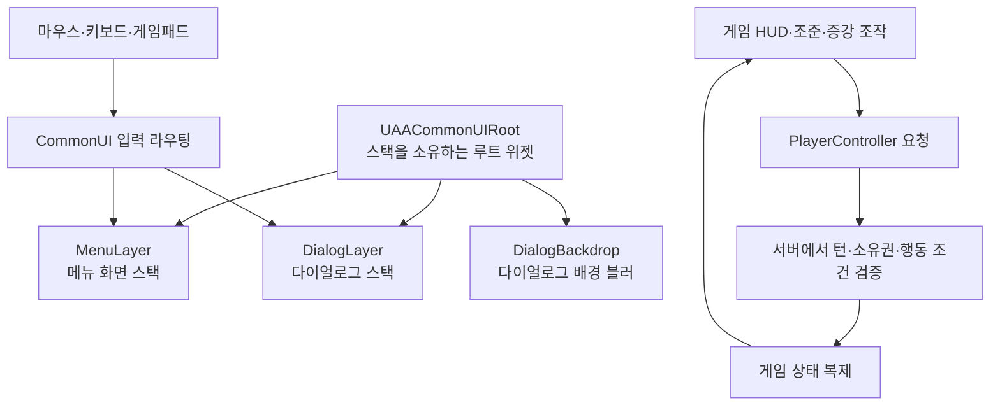

## 요구사항

- 메뉴 → 팝업 → 뒤로 가기가 반복돼도 <strong>입력 모드와 포커스가 항상 올바르게 복원</strong>돼야 한다.
- 한 화면에서 키보드·마우스, 게임패드, 터치를 함께 지원해야 한다.

## 왜 이 기술을 선택했나

각 위젯이 `SetInputMode`를 직접 호출하는 구조에서는 닫는 경로가 하나만 늘어도 복원이 어긋나, <strong>입력 모드와 포커스 복원을 빼먹는 실수</strong>가 계속 나왔다. 그래서 각 위젯은 "나는 어떤 입력 모드가 필요한가"만 선언하고, 적용과 <strong>복원은 CommonUI의 Activation Stack이 대신</strong> 처리하는 선언적 레이어를 택했다. 입력 장치는 역할을 섞지 않도록 CommonInput·CommonUI·Enhanced Input에 나눠 맡겼다.

## 어떻게 구현했나

### 한눈에 보는 아키텍처

### 선언적 레이어

`UAACommonUIRoot`(`WBP_AACommonUIRoot`)가 `UCommonActivatableWidgetStack` 2단을 소유한다.

| 레이어 | 담당 |
| --- | --- |
| `MenuLayer` | 메인 메뉴 · 로비 등 기본 화면 |
| `DialogLayer` | 방 생성 · 참가 · 설정 · 종료 확인 팝업 |
| `Root` | Dialog push 시 BackgroundBlur 배경을 켜고, 마지막 Dialog가 닫히면(`HandleDialogWidgetDeactivated`) 해제 |

### 장치별 입력 분담

| 시스템 | 담당 |
| --- | --- |
| CommonInput | 장치 감지, 키 힌트 아이콘 전환 |
| CommonUI | 메뉴 포커스 이동, 뒤로 가기 |
| Enhanced Input | 포커스 이동·스틱 조준·장력 조절·발사 등 인게임 액션 |

터치는 `AATouchGesture`가 핀치 줌·두 손가락 패닝·화면 공간 당김을, `AATouchControls`가 주사위 건너뛰기 등 화면 버튼을 맡는다. PlayerController가 장치별 입력을 <strong>동일한 게임 명령</strong>(Piece · 방향 · 세기 · TurnId)으로 변환한다.

### 게임패드 전용 입력 경로

가상 커서 클릭과 게임 확정 키가 같은 A 버튼을 두고 경쟁해, 메뉴에서 누른 A가 판 위 알 선택으로 새어 나가는 문제가 있었다. 그래서 역할을 세 단계로 나눴다.

| 단계 | 담당 |
| --- | --- |
| `UAAUIInputSubsystem` (LocalPlayer 서브시스템) | UI Accept/Back 매핑 컨텍스트를 우선순위 100으로 유지하고, Slate 입력 전처리기를 등록 |
| `FAAGamepadConfirmInput` (`IInputProcessor`) | A · B · Menu 중 <strong>게임 확정 키만</strong> CommonUI보다 먼저 처리하고, 처리한 키는 Key Up까지 소비해 중복 클릭을 막는다. 메뉴 탐색은 CommonUI에 그대로 넘긴다 |
| `UAACommonUIActionRouter` (커스텀 Analog Cursor) | 메뉴가 열려 있으면 메뉴 포인터로 동작해 A가 커서 아래를 클릭하고, 판 위에서는 게임 좌표 커서를 Slate 커서에 동기화 |

- <strong>장치 전환</strong>: 0.25 미만의 스틱 드리프트는 무시하고, 실제 마우스 이동만 키보드·마우스로 전환한다. 장치가 바뀌면 진행 중인 드래그·조준은 확정하지 않고 취소한다(`HandleActiveInputMethodChanged`).
- <strong>대상 지정 커서</strong>: 증강 대상·텔레포트·벽 설치처럼 판 위 지점을 고르는 단계에서는 화면 중앙에서 시작하는 커서를 LS/십자키로 옮기고 A로 확정, B로 무장 해제까지 되돌린다.
- <strong>조작 체계</strong>: A 선택·확정 · B 취소 · RS 방향 · LB/RB 장력(1% 단위) · RT 발사 · LT 홀드 + RS/십자키 카메라 · Y 증강 · Menu 일시정지.
- <strong>상황별 안내</strong>: `UAAMatchControlHints`가 입력 장치와 단계(상대 차례 · 알 선택 · 조준 · 대상 지정 · 카메라)에 맞춰 안내 문구를 실시간으로 바꾸고, 포커스된 알 위에는 알 색으로 칠한 크레용 화살표(`T_SelectionArrowCrayon`)를 띄운다.

### 인게임 매뉴얼

`UAAControlsDialog`는 조작 · 모드 · 증강 3개 탭을 가진 다이얼로그다. 각 탭은 Slate 기반 커스텀 `UWidget`(`UAAControlDiagram`, `UAAModeGuide`, `UAAAugmentGuide`)이고, 증강 가이드는 <strong>검색어 · 티어 · 모드 필터</strong>를 제공한다. 턴제/실시간 모드를 바꾸면 같은 카드라도 해당 모드의 규칙 설명(예: 저금 이자 = 턴제는 내 턴 종료마다, 난장판전은 전투 시간 5초마다)으로 바뀐다.

### 행동 중 채팅 페이드

매치 채팅은 패널 대신 <strong>10초 뒤 사라지는 텍스트 오버레이</strong>(최대 6줄, 100자)로 두고, 보낸 사람 이름은 서버가 정한 알 색으로 칠한다. 조준·발사 구간에는 불투명도 0.3까지 부드럽게 흐려져 보드를 가리지 않고, 입력을 시작하면 즉시 선명해진다(`UAAInGameChat::SetActionFaded`). 채팅 내용 복제는 별도 액터 `AAAMatchChat`이 담당하고, 감정 표현은 4종 이모트 휠(`UAAEmoteComponent`)로 보완한다.

## 결과

- 닫는 경로가 늘어나도 입력 모드·포커스 복원은 스택이 처리해, 위젯마다 복원 코드를 둘 필요가 없어졌다.
- 서버는 장치를 전혀 모른 채 턴과 소유권만 검증한다.
- 메뉴의 A 입력이 게임 확정으로 새어 나가거나, 장치를 바꾸는 순간 조준이 의도치 않게 발사되는 경로가 사라졌다.

> 검증 범위는 Windows의 키보드·마우스와 Xbox/Generic Gamepad이고(게임패드 장력·취소는 `ProjectA.Input.Gamepad.PowerAndCancellation` 자동화 테스트와 `AA.GamepadAudit`으로 확인), 터치는 `AA.TouchAudit`으로 입력 경로만 확인했다. 콘솔 인증이나 플랫폼 SDK 연동은 포함하지 않는다.
