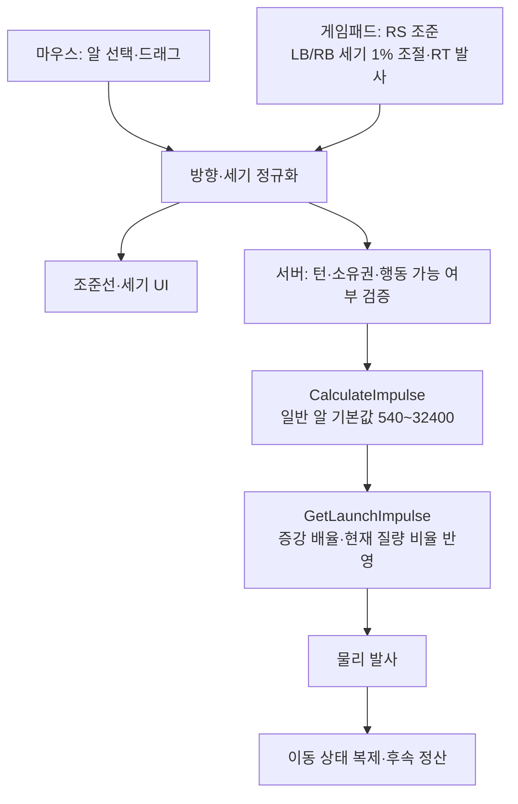

## 요구사항

- 알을 누른 채 반대 방향으로 당긴 거리를 발사 충격량으로 변환해야 한다.
- 알이 멈출 때까지 기다리는 시간이 길어 한 판이 늘어졌다. 턴을 빠르게 하되, <strong>기존에 맞춰둔 보드 크기·증강 사거리는 그대로</strong> 유지해야 한다.
- 조준선은 줌과 무관하게 읽히고, 키보드·마우스·터치·게임패드가 같은 플릭 명령을 만들어야 한다.

## 왜 이 기술을 선택했나

- <strong>거리 하나만 힘을 결정</strong>한다. 클릭 유지 시간이나 커서 속도는 힘에 반영하지 않아 입력이 예측 가능하다.
- 발사 세기만 올리면 알이 더 멀리 날아가 보드 크기·증강 사거리가 전부 어긋난다. 그래서 `AAPhysicsTempo` 하나로 모든 물리 상수를 함께 스케일해 <strong>거리는 그대로, 시간만 단축</strong>했다.
- 충돌 이후 궤적까지 예측 표시할 수 있었지만 <strong>일부러 직선 조준선까지만</strong> 보여줬다.

> 다중 충돌까지 보여주는 완전 예측은 비용이 크고, 무엇보다 <strong>"이 각도면 저기 맞겠지"라고 추측하는 재미(스킬 요소)를 없앤다.</strong> 대신 이 예측을 A티어 증강 <strong>첨단 조준경</strong>의 보상으로 돌렸다. 조준이 0.3초 멈춘 뒤에만 예측 경로·착탄점을 녹색 홀로그램으로 보여주고, 예측용 물리 바디는 풀링하고 갱신 횟수에 예산을 두었다.

## 어떻게 구현했나

### 한눈에 보는 아키텍처



### 파워 매핑

| 항목 | 값 | 위치 |
| --- | --- | --- |
| 유효 드래그 거리 | 8 ~ 1,400cm (그 이상은 최대 힘 고정) | `MinFlickDistance` / `MaxFlickDistance` |
| 기본 충격량 | 240 ~ 14,400 | `MinImpulse` / `MaxImpulse` |
| 발사 배율 | 2.25 (= 1.5 × 템포 1.5) | `ShotPowerMultiplier` |
| <strong>기본 알 기준 충격량</strong> | <strong>540 ~ 32,400</strong> (최대값은 매치마다 ±10%) | `CalculateImpulse` 반환값. 실제 발사는 `GetLaunchImpulse`에서 질량·증강 배율 추가 적용 |
| 곡선 지수 | 1.0 (선형) | `ImpulseExponent` |

```cpp
// 드래그 거리를 0~1로 정규화한 뒤 지수 곡선을 태워 충격량으로 변환
const float CurvedStrength = FMath::Pow(NormalizedStrength, ImpulseExponent);
return FMath::Lerp(MinImpulse, MaxImpulse * MatchVariation, CurvedStrength) * ShotPowerMultiplier;
```

### 물리 템포

| 상수 | 스케일 | 근거 |
| --- | --- | --- |
| `SpeedScale` | 1.5 | 초속도 배율 |
| 선형·각 감쇠 (0.60 / 3.0) | × 1.5 | 감쇠 감속은 속도에 비례 → 속도 배율만큼 키우면 이동 거리 유지 |
| 마찰 (보드 0.38 · 알 0.28/0.32 · 빙판 0.025) | × 2.25 (= SpeedScale²) | 마찰 감속은 일정 → $v^2 / 2\mu g$ 에서 거리를 유지하려면 $\mu$를 속도²만큼 |
| 중력 증강 · 충격파 · AI 마찰 모델 | 같은 상수 참조 | 증강과 AI 예측이 새 템포와 어긋나지 않도록 |

### 조준 표현

- `UAAAimWorldVisualComponent`: 커스텀 `UMeshComponent` + `FPrimitiveSceneProxy`가 매 프레임 `FDynamicMeshBuilder`로 리본·핸들 원판을 생성한다. 깊이 테스트 섹션을 따로 둬 <strong>조준선이 벽·알 뒤로 자연스럽게 가려진다.</strong>
- 월드 폭을 화면에 투영해 <strong>줌과 무관하게 일정한 선 두께</strong>를 유지하고, 알의 파스텔 색을 채도 높은 색으로 변환해 플레이어별로 구분한다.
- 크레용 텍스처 화살표·핸들, 파워 구간별 피드백(`UAAAimPresentationComponent`)으로 손그림 아트 톤에 맞췄다.
- 조준 중 카메라 패닝을 없애고, <strong>현재 방향의 풀파워 당김이 화면 밖으로 잘릴 때만 줌아웃</strong>하는 당김 공간 줌으로 바꿨다.
- 터치는 화면 짧은 변의 28%를 당기면 풀파워가 되도록 화면 공간으로 매핑하고(`AATouchGesture`), 게임패드는 RS로 방향을 정하고 LB/RB로 장력을 1%씩 조절한 뒤 RT로 발사해 같은 플릭 명령을 만든다.

## 결과

- 템포 1.5배로 한 턴이 빨라졌고, `AA.PhysicsTempoAudit`가 템포 변경 전후의 <strong>지면 이동 거리가 같은지</strong> 자동으로 검증한다.
- 커서 이동과 당김 거리가 정확히 일치하고, 모든 입력 장치가 같은 플릭 명령으로 수렴한다.
