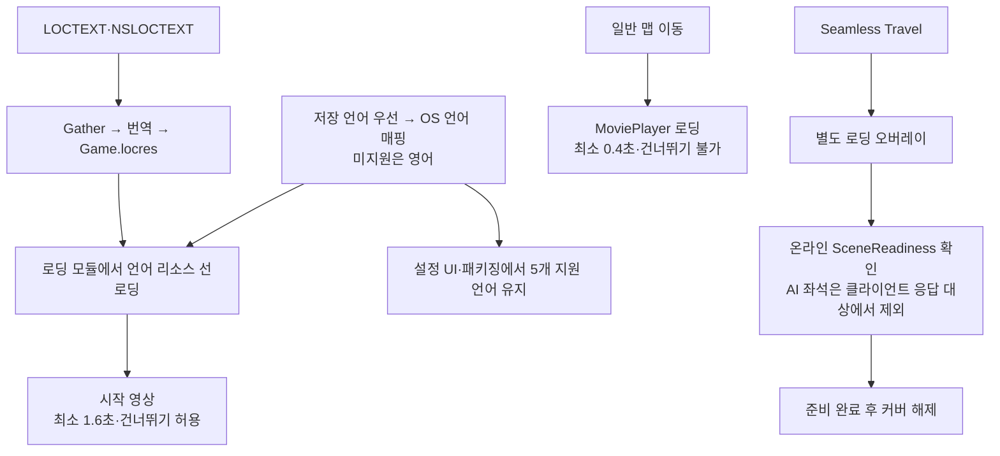

## 요구사항

한국어 · 영어 · 일본어 · 중국어 간체 · 중국어 번체 5개 언어를 지원해야 했습니다. 같은 문장도 언어마다 길이가 크게 달라 레이아웃이 깨지지 않아야 하고, 게임을 켠 <strong>첫 화면부터</strong> 사용자 언어로 보여야 했습니다.

---
## 왜 이 기술을 선택했나

- 텍스트는 String Table 없이 소스의 `LOCTEXT` / `NSLOCTEXT`로 작성하는 표준 FText 파이프라인을 썼습니다.
- 로딩 스크린은 `PreLoadingScreen` 단계에 로드되는 별도 모듈 `ProjectALoadingScreen`으로 분리했습니다. 엔진 초기화 전에 해당 언어의 `Game.locres`를 먼저 읽어야 <strong>첫 화면부터 현지화된 팁</strong>을 보여줄 수 있기 때문입니다.
- 지원 언어 목록이 이 모듈에 있어, 메인 모듈이 이를 재사용합니다.

---
## 어떻게 구현했나

### 한눈에 보는 아키텍처

### 파이프라인

- Gather → `.po` → 언어별 `Game.locres`로 컴파일합니다.
- `ResolveStartupLanguage`는 저장된 지원 언어를 우선하고, 없으면 OS 언어를 지원 언어로 매핑합니다. 중국어는 `Hans` / `Hant` 스크립트와 `tw/hk/mo` 지역을 구분합니다. 지원하지 않는 언어는 영어로 시작합니다.
- 언어 변경은 `UAASettingsSubsystem`이 `SetCurrentLanguageAndLocale`로 즉시 적용합니다.

### 언어별 레이아웃과 폰트

`AALocalizedLayout`에서 언어별 크기·줄바꿈을 보정합니다. 증강 카드는 손글씨 폰트(예은체)를 쓰고, 일본어·중국어 글리프가 없는 부분은 컴포지트 폰트의 Fallback(`FF_InternationalCJK`)으로 채웁니다.

### 로딩 스크린

- 시작 화면은 영상(있으면) 또는 애니메이션 종이 화면을 사용하며 최소 표시 시간은 1.6초, 영상 건너뛰기는 허용합니다. 일반 맵 이동 화면은 최소 0.4초이며 <strong>건너뛰기를 허용하지 않습니다</strong>(`bMoviesAreSkippable = false`).
- 일반 맵 이동은 `PreLoadMap` / `PostLoadMapWithWorld`와 MoviePlayer를 사용해 Slate `SAALoadingScreen`을 띄웁니다. <strong>심리스 트래블은 이동 상태를 감지하는 GameViewport Slate 오버레이</strong>로 처리합니다.
- 로딩 커버는 트래블 <strong>전에</strong> 띄우고, 새 맵의 텍스처 스트리밍 등 씬 준비(`SceneReadiness`)가 끝날 때까지 유지합니다.
- "다른 플레이어 대기" 상태는 bool이 아니라 그 상태를 건 컨트롤러의 약참조로 관리한다(`UAASceneLoadingState::SetWaitingForPlayers`). 로비 → 게임 트래블로 컨트롤러가 바뀌어도 이전 대기 상태가 남지 않아, 클라이언트가 최대 60초 로딩 화면에 갇히던 문제가 사라졌습니다.

---
## 결과

- 지원 언어 목록은 `AALanguages::GetSupported()` 한 곳에서 정의하고, 패키징 설정(`CulturesToStage`)도 같은 5개만 포함합니다.
- 덜 그려진 화면이 보이지 않고, 멀티에서는 로딩 커버가 전원의 씬 준비를 기다리는 배리어로 쓰입니다.
