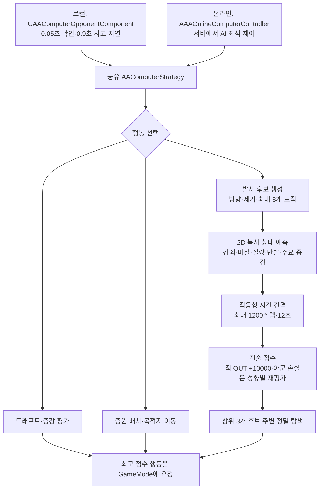

## 요구사항

솔로 매치(`LocalAI=1`)의 2번 좌석뿐 아니라, 온라인 로비에서 추가한 <strong>AI 좌석</strong>도 사람과 같은 게임 규칙으로 진행해야 한다. 발사·드래프트·증강 사용·목적지 이동을 처리하고, 플레이어가 AI의 행동을 인지할 여유도 둔다.

## 왜 이 기술을 선택했나

Chaos로 후보마다 시뮬레이션을 돌리면 정확하지만, 실제 월드 상태를 건드리거나 복제해야 하고 후보 수만큼 비용이 든다. 그래서 <strong>질량·감쇠·마찰·반발계수와 주요 증강 상태를 반영한 2D 예측</strong>을 따로 두고, 실제 월드에는 손대지 않는다.

## 어떻게 구현했나

### 한눈에 보는 아키텍처



로컬 상대는 `AAAlkagiGameMode`의 기본 서브오브젝트인 `UAAComputerOpponentComponent`가 맡는다. <strong>0.05초 주기</strong>로 갱신하며 첫 행동 전에는 <strong>0.9초</strong>를 기다린다. 온라인은 서버 전용 `AAAOnlineComputerController`가 AI PlayerState와 좌석을 등록해 처리하고, 양쪽 모두 `AAComputerStrategy`의 예측·평가 함수를 사용한다.

```text
ChooseAction
 ├─ 드래프트 / 증강 사용 → AAComputerStrategy::ScoreAugment(카드, 티어, 보드 상황)
 ├─ 증원 배치 → 12개 각도 평가
 ├─ 비숍 이동 → 목적지 점수 (적 처치 가중치 큼)
 └─ 발사 → 후보 방향 × 기본 9단계 세기 → 상위 후보 미세 탐색
          점프샷은 GetMasseTrajectory 역산 → EvaluateJumpShot
```

- 후보 방향: 중앙 복귀 방향과 ±45°를 포함하고, 거리·보드 외곽·약점 연결 우선순위로 <strong>최대 8개 표적</strong>의 정면·비껴치기·배치 방향을 만든다. 바람이 있으면 보정 방향을 추가하며, 로컬 샷 검색은 벽에 막힌 경로를 제외한다.
- 예측: 감쇠·마찰 감속·반발계수·질량 기반 원-원 충돌과 옥상 바람을 반영한다. 로컬 보드 표면 캐시는 <strong>5cm 격자</strong>를 사용하며, 일반 샷 예측은 속도와 반경에 따른 적응 시간 간격으로 <strong>최대 1,200스텝 또는 12초</strong>까지 계산한다.
- 상태 반영: 방어막 · 빙결 · 돌탑 · 얼음땡 · 랜서 · 포섭 상태와 점프샷의 포물선 궤적(`GetMasseTrajectory`)을 모델링한다.
- 점수: 일반 적 알의 <strong>아웃</strong>은 기본 +10,000으로 평가한다. 초기 예측의 아군 아웃 벌점 −22,000은 최종 `ScoreTactics`에서 <strong>AI 성향·수적 우세에 따른 손실 비용으로 다시 계산</strong>한다. 전멸에는 −100,000을 추가해 마지막 알을 잃는 선택을 억제한다.
- 방해 증강: 상대의 인증(방향 입력)·혼란(방향 반전)에는 AI도 50% 확률로 실패해, 사람에게만 효과가 있는 카드가 되지 않게 했다. 공중 부양 확률도 벌점으로 뺀다.
- 저금: 통장에 들어간 상대 알은 충돌 후보에서 빼되, 남은 적 전력 계산에는 잔액을 더해 "판 위 알이 적다"고 오판하지 않게 했다.

### 템포 변경과 동기화

물리 템포를 1.5배로 올릴 때 AI의 마찰 모델도 같은 `AAPhysicsTempo` 상수를 참조하도록 맞췄다. 한쪽만 바뀌면 AI가 계속 짧거나 길게 쏘게 된다.

## 결과

실제 월드를 건드리지 않고 후보 샷을 평가하는 로컬 상대와 온라인 AI 좌석을 구현했다. 온라인 AI는 순차·동시확정·실시간 정책에 맞춰 공통 GameMode 명령을 호출하며, 사람 클라이언트의 로딩 응답·재시작 투표 대상에서는 제외한다.

`ProjectA.AI.SafetyAndAugmentStrategy`(자멸 방지·증강 선택), `AAComputerOpponentTests`, `ProjectA.Online.Computer.AllModes` 등으로 관련 동작을 검사한다. 예측은 근사이므로 다중 연쇄 충돌에서는 실제 결과와 다를 수 있다.
