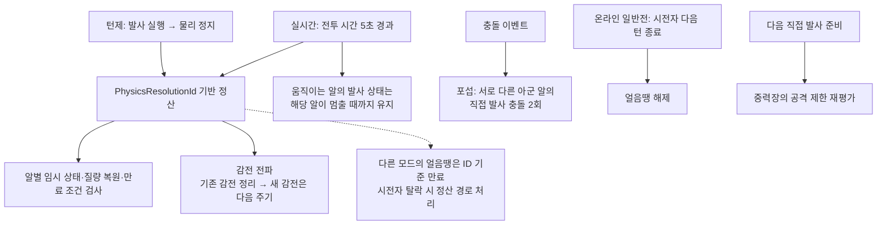

## 요구사항

"다음 플릭 1회까지 유지"되는 임시 증강은 <strong>한 번의 발사가 끝날 때 정확히</strong> 꺼져야 한다. 또한 임시 효과가 끝났을 때 <strong>기본값이 아니라 그 시점의 영구값</strong>으로 돌아가야 한다. 육중함(영구) 적용 후 가벼움(임시)을 쓰면, 가벼움이 끝난 뒤 4.2kg이 아니라 8.4kg으로 복구되어야 한다.

## 왜 이 기술을 선택했나

임시 증강을 `Duration = 3초` 같은 GameplayEffect로 만들면 어긋난다.

- 연쇄 충돌이 길어지면 <strong>아직 굴러가는 중에 효과가 꺼진다.</strong>
- 반대로 충돌이 빨리 끝나면 <strong>다음 턴까지 효과가 남는다.</strong>
- 클라이언트마다 물리 정지 시점이 미세하게 달라 <strong>상태 불일치</strong>가 생긴다.

그래서 시간 대신 <strong>게임 규칙상의 사건</strong>(물리 정산 종료)에 수명을 묶었다.

## 어떻게 구현했나

### 한눈에 보는 아키텍처



### 정산 ID

턴제 서버가 물리 Resolve를 시작할 때마다 `PhysicsResolutionId`를 증가시킨다. 발사 상태와 빙결·해빙 보호 같은 효과는 이 ID를 비교하고, 정산 종료 시 `ResolveAugmentResolution(Id)`로 정리한다. 임시 질량은 같은 종료 경로의 `RestoreTemporaryMass()`로 복구한다. <strong>모든 효과가 생성 ID를 저장해 일괄 삭제되는 구조는 아니며</strong>, 효과마다 종료 조건을 둔다.

```text
ResolutionId = 7  → 발사 → 충돌 연쇄(2.4초) → 전원 정지
                  → 발사 상태 정리 · 임시 질량 복구 · 정산 ID 기반 만료 검사
ResolutionId = 8  → 발사 → 충돌 연쇄(0.8초) → 전원 정지
                  → 발사 상태 정리 · 임시 질량 복구 · 정산 ID 기반 만료 검사
```

### 영구/임시 값의 복구 경로 분리

영구 증강은 어트리뷰트 기준선을 옮기고, 임시 증강은 그 위에 얹었다가 정산 시점에 `RestoreTemporaryMass`로 걷어내는 2층 구조다.

| 단계 | Mass | 비고 |
| --- | --- | --- |
| 기본 | 4.2kg | `PermanentMassKg` 기본값 |
| 육중함 적용 | 8.4kg | 영구값 갱신 (×2.0) |
| 가벼움 적용 | 2.1kg (임시) | 영구값은 8.4kg으로 보존 |
| 정산 종료 | <strong>8.4kg</strong> | 4.2kg이 아닌 영구값으로 복구 |

> 가벼움은 이 버그를 발견한 초기 카드로, 현재 드래프트 풀(39종)에서는 빠져 있다. 복구 경로 분리는 그대로 유지된다.

### 정산 ID에 묶인 규칙들

증강별 수명과 충돌 출처를 구분하기 위해 <strong>정산 ID·턴 ID·발사 일련번호·시전자 좌석</strong>을 역할에 맞게 사용한다. 턴제 정산 종료에서는 서버가 각 알의 `ResolveAugmentResolution(Id)`를 호출하고, 전파·턴 종료 규칙은 별도 컴포넌트와 서브시스템이 처리한다.

| 규칙 | 정산 ID 활용 |
| --- | --- |
| 얼음땡 | `FrozenAtResolutionId` 비교로 같은 정산에서 방금 얼린 알의 재타격 파괴를 막음. <strong>온라인 순차 일반전은 시전자의 다음 턴 종료에 해동</strong>(`FreezeInstigatorSeat`·`FrozenAtTurnId`); 시전자 탈락 시 기존 정산 기한으로 전환. 그 외 경로는 `AutoThawResolutionId = 얼린 ID + 2`. 해동 후 다음 정산 ID까지 재빙결 보호 |
| 포섭 | `FirstRecruiter`와 다른 아군 알의 직접 몸통 타격이어야 전향. 같은 알의 재발사는 불인정. 직접 몸통 발사 상태는 이동 정지 또는 정산 시 종료 |
| 만유인력 | 발사·피인력 알의 공격 증강을 제한하고 실제 충돌은 공명에 집계. <strong>공격 제한은 정산 때 지우지 않고 다음 직접 발사 준비 시 다시 결정</strong>해 지연 타격을 차단 |
| 포식자 | 연쇄 충돌이 끝날 때까지(`HasUnsettledLaunchContacts`) 기다렸다가 재공격 여부 결정, 발사 출처는 `PieceLaunchSerial`로 추적 |
| 점프샷 | 발사 준비 플래그를 정산 시 초기화 |
| 감전 | 직접 충돌 및 발사 정지 후 반경 650 감전. `UAAElectricShockComponent::ResolvePropagation`이 기존 감전을 전파한 뒤 원래 감전을 해제하며, 새 감전은 다음 전파 주기부터 처리 |

## 결과

턴제에서는 연쇄 충돌의 종료에 맞춰 발사 상태와 임시 질량을 정리하고 영구값을 보존한다. <strong>실시간 난장판전은 전투 시간 5초마다 정산 ID를 진행</strong>하면서 감전 전파·분열·이자 같은 주기 규칙을 처리한다. 이때 움직이는 알의 발사 상태는 유지하고, 개별 이동 종료 조건을 만족할 때 정리하므로 턴제의 전원 정지 대기와는 구분된다.
