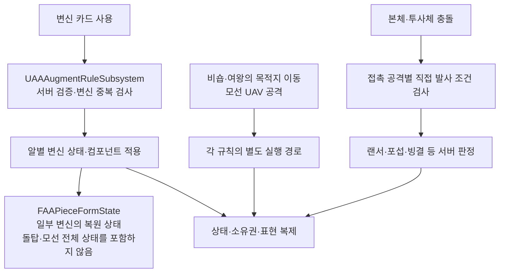

## 요구사항

변신은 "수치가 조금 오르는" 증강이 아니라 <strong>알의 공격 방식이 바뀌는</strong> 카드입니다. 10종이 한 판에 섞이므로, 서로 조합돼도 충돌하지 않는 규칙이 먼저 필요했습니다.

---
## 왜 이 기술을 선택했나

조합 규칙을 먼저 정하고, 판정은 서버 권한 컴포넌트에 모았습니다.

- 알 하나의 변신 상태는 `HasTransformationAugment`로 검사하고, 형태 교체 시 이전 변신을 정리합니다. 일반적인 형태 상태는 `FAAPieceFormState`로 저장·복원하며, 돌탑·모선 편대 같은 별도 상태는 전용 컴포넌트·액터가 관리합니다.
- 얼음땡·랜서·포섭 등 <strong>접촉형 변신 공격은 직접 발사 여부를 검증</strong>합니다. 밀려난 알이나 포식자 자동 재공격으로 재발동하지 않습니다. 비숍·퀸의 목적지 이동과 모선 UAV 출격은 각 전용 규칙으로 처리합니다.
- 만유인력으로 끌어당긴 이동에서는 발사한 알과 끌려온 알 모두 <strong>공명 외 공격 증강이 발동하지 않고</strong>, 실제 충돌만 공명에 집계됩니다. (초기에는 끌려온 알도 변신 공격을 1회 발동했지만, 연쇄가 과해 2026.10.18에 공명 시너지로 한정)
- 모든 판정은 서버에서 하고, 결과(균열·빙결·소유권)만 복제합니다.

---
## 어떻게 구현했나

### 한눈에 보는 아키텍처

| 카드 | 동작 | 구현 |
| --- | --- | --- |
| 전열보병 (A) | 장력 30% 이하는 일반 이동, 초과하면 제자리에서 머스킷 사격 | 복제 액터 `AAAInfantryBullet`이 매 틱 반경 3 스윕. 명중 시 `1.34 × 접근 속도 × 환산 질량`의 충격량 |
| 포섭 (S) | 직접 발사한 몸통으로 표식 → <strong>서로 다른 아군 알</strong>을 직접 발사해 다시 맞히면 전향. 같은 알의 재발사는 불인정 | `UAARecruitmentComponent` · `ChangeAllegiance(Seat, Color)`. 실시간 모드도 같은 소유권 전환 |
| 랜서 (B) | 시작 정면으로 고정된 랜스. 정면 충돌 1회 균열, 2회 파괴 | `UAALancerComponent`의 선분 교차 판정(`IntersectsLance`), 발사당 적마다 1회(`HitLaunches`) |
| 얼음땡 (S) | 닿은 적을 얼리고, 이미 언 적이나 마지막 알은 파괴 | `AAAlkagiPiece::TryApplyIceCollision` · 정산 ID 비교. 온라인 순차 일반전에서는 시전자의 다음 턴 종료에 자동 해동하며, 조작 가능한 알이 없으면 강제 해동 |
| 모선 (S) | 알 하나는 모선, 나머지는 UAV로 변신. 모선 발사 후 UAV가 순서대로 자동 공격하고, 모선이 장외로 나갈 때 UAV 하나를 희생해 구함 | UAV는 자동 공격 중에만 알 충돌을 켜 평소에는 판을 어지럽히지 않음 |
| 감전 (A) | 직접 닿은 적과 정산 후 반경 650 안의 적을 감전시켜 발사 불가로 만듦. 감전은 정산마다 번짐 | 정산 ID 기준 전이(`ResolveElectricShots`), 서로 다른 출처의 감전만 갱신 |

그 외 피앙케토(비숍 대각 이동), 점프샷(포물선 당구공), 프로모션(폰 → 퀸 승급), 돌탑 쌓기(초기 체력 = 합친 알 환산 수 × 2, `GetStrengthMultiplier = 1 + 0.15 × 남은 체력`; 이 배율은 질량과 발사 배율에 반영)가 같은 규칙을 따릅니다. 파괴된 알은 형태별(바둑알·당구공·폰·퀸·비숍·나이트·랜스) 사전 분할 메시로 흩어진다(`AAAPieceBreakEffect`).

### 변신 카운터 — 육중함의 1회 인내

변신하지 않은 일반 알에게도 버틸 수단을 주는 카운터 규칙입니다. 육중함을 가진 <strong>변신하지 않은 알</strong>은 얼음·랜스·저주의 처형을 1회 버티고, 버틴 대가로 육중함이 해제된다(`TryEndureTransformationExecution`).

---
## 결과

<iframe src="https://www.youtube-nocookie.com/embed/Sf7r9xehXx8" title="변신 증강 시연" loading="lazy" style="width:100%;aspect-ratio:16/9;border:0;border-radius:12px" allow="accelerometer; clipboard-write; encrypted-media; gyroscope; picture-in-picture" allowfullscreen></iframe>

> AI가 얼음 공격으로 이 규칙을 정확히 처리하는지는 자동화 테스트 `ProjectA.Augments.HeavyEndurance`와 PIE 감사 `AA.EnduranceAudit`로 검증합니다.
