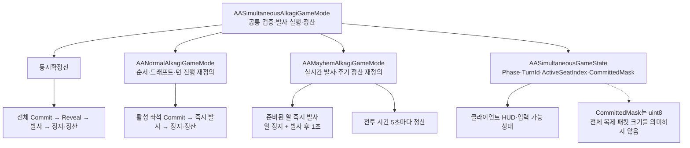

## 요구사항

알까기를 순차 턴으로만 만들면 4인 기준 <strong>내 차례까지 기다리는 시간이 대부분</strong>입니다. 실시간으로 풀면 핑이 낮은 사람이 먼저 쏴서 유리해집니다. 반대로 동시 턴만 두면 "상대가 쏘는 걸 보고 대응하는" 알까기 본연의 재미가 사라집니다. 정답이 하나가 아니라서 <strong>방장이 고르게</strong> 해야 했습니다.

---
## 왜 이 기술을 선택했나

모드마다 규칙 코드를 따로 두면 증강·정산이 모드 수만큼 갈라집니다. 그래서 <strong>공통 온라인 실행기와 모드별 턴 진행을 분리</strong>했습니다. 모든 온라인 모드는 `AASimultaneousAlkagiGameMode`를 베이스로 하고, `GetTurnPolicy()`로 정책을 알립니다. 일반전은 주사위·라운드 순서 등을, 난장판전은 실시간 발사·Tick·드래프트 일시정지 등을 추가로 재정의합니다. GameState는 `IsSequentialTurns()` / `IsRealtime()`로 정책을 노출하고, 보드·증강 규칙과 여러 검증 함수를 공유합니다.

| 모드 | GameMode | `EAAOnlineTurnPolicy` | 특징 |
| --- | --- | --- | --- |
| 일반전 (기본 · 빠른 매칭) | `AANormalAlkagiGameMode` | `Sequential` | 주사위로 순서 결정 후 한 좌석씩 진행. 싱글플레이와 같은 턴 규칙 |
| 동시확정전 | `AASimultaneousAlkagiGameMode` | `Simultaneous` | 전원 비공개 조준 → Commit → 일괄 Resolve |
| 난장판전 | `AAMayhemAlkagiGameMode` | `Realtime` | 1인 알 5개 · 아웃된 알은 복귀 없음. 알마다 <strong>이동 종료와 발사 시점부터 1초 경과</strong>를 모두 만족하면 다시 발사하고, 쏜 알이 멈추는 동안 다른 알 조작 가능. 15초마다 드래프트(선택 중 월드 정지 → 3초 카운트다운 후 재개) |

초기 일반전은 증강 사용만 전원이 동시에 예약(`ReserveAugment`)하고 발사는 순서대로 하는 혼합 구조였고, 싱글플레이는 처음부터 순수 순차 턴이었습니다. <strong>싱글과 온라인 일반전의 턴 규칙을 하나로 맞추는 것</strong>도 목표였습니다.

---
## 어떻게 구현했나

### 한눈에 보는 아키텍처



### 일반전 — 싱글 턴 규칙과 통일

- 동시 예약·해결 단계와 공용 드래프트 풀을 제거하고, 증강은 <strong>자기 차례에 바로 사용</strong>하도록 바꿨습니다.
- 드래프트 시점을 `AASequentialTurnRules::IsDraftTurn`(개인 1·3·6번째 턴) 하나로 모아 싱글 `AAAlkagiGameMode`와 공유합니다.
- 구버전 클라이언트가 보내는 예약 RPC는 `ReserveAugment`가 항상 `false`를 반환해 거부합니다.

순차 모드도 별도 코드 경로를 만들지 않고 <strong>활성 좌석 1명만 참여하는 Commit 파이프라인</strong>으로 처리합니다. Reveal 시간을 0으로 두면 확정 즉시 `ApplyResolvedFlicks`가 실행돼, 검증·정산 코드를 동시확정전과 그대로 공유합니다.

### 동시확정전 — Commit-Resolve

확정(Commit)은 발사가 아니라 <strong>서버에 조준값을 저장하는 행위</strong>다. 전원 확정 또는 타이머 종료(`AutoCommitMissingPlayers`) 후 서버가 저장된 모든 플릭을 <strong>동일 물리 프레임</strong>에 적용합니다.

```text
Draft → Aiming(비공개) → Commit → Revealing(조준선 짧게 공개)
      → ApplyResolvedFlicks(전원 동시 발사) → PhysicsSettling → 장외·탈락 일괄 정산
```

| 데이터 | 위치 | 공개 범위 |
| --- | --- | --- |
| 조준 방향·파워 | GameMode의 `FAAPendingFlick` | 서버 전용 (Resolve 전까지 비공개) |
| 누가 확정했는지 | `CommittedMask` (uint8 비트마스크) | 전체 복제 |
| 발사 결과 | `TArray<FAAResolvedFlick>` | Resolve 시점에 전체 복제 |
| 내 손패·드래프트 후보 | PlayerState | 소유 클라이언트 전용 |

### 서버 검증

`ServerCommitSimultaneousAim`은 먼저 `ActionRpcBudget.TryConsume()`으로 RPC 남용을 막고, 재접속 대기 중이면 무시합니다. 이후 `ValidateAim`이 다음을 모두 통과해야 저장합니다.

- `TurnId == CurrentTurnId`
- 세기가 유한값이고 (0, 1] 범위, 방향이 NaN·영벡터가 아님
- 페이즈가 `Aiming`이고, 해당 좌석이 행동 가능하며 아직 확정하지 않았음
- `Piece->GetPlayerIndex() == Seat` (알 소유권)

비숍 이동처럼 목적지를 고르는 증강은 `FAADestinationMoveRules::Evaluate`로 한 번 더 검증합니다.

### 동일 프레임 적용

`ApplyResolvedFlicks()`가 한 번의 호출 안에서 저장된 플릭을 <strong>좌석 순서대로 순회하며 임펄스를 적용</strong>합니다. 직전에 `PreparePhysicsResolution(PhysicsResolutionId + 1)`로 이번 정산 ID를 확정하고, 각 알은 그 ID에 임시 증강의 수명을 묶습니다.

---
## 결과

- 세 모드가 보드·증강 규칙과 공통 검증을 공유합니다. 순차·동시확정전은 Commit-Resolve 경로를 사용하고, 실시간전은 즉시 발사와 주기 정산을 별도로 구현합니다.
- 조준값 대신 <strong>"확정했다"는 비트만 복제</strong>해, 4인 준비 여부를 `uint8` 하나로 표현합니다. 조준값은 Reveal 전까지 일반 클라이언트에 복제하지 않습니다. 이는 상태 표현 크기이며 실제 네트워크 패킷 전체가 1바이트라는 뜻은 아닙니다.

> 실시간 난장판전은 PhysicsSettling을 기다리지 않으므로, "정산마다" 동작하던 증강(분열 · 감전 · 저금 이자 · 락온 유예)은 <strong>전투 시간 5초 주기</strong>로 바꿔 처리합니다. 2026.10.18에 목숨·리스폰 구조를 걷어내고 턴제와 같은 <strong>알 5개 · 탈락 시 복귀 없음</strong> 규칙으로 통일하면서, 포섭은 턴제와 같은 소유권 전환으로 돌아갔고 제외했던 락온 · 방목 · 모선도 실시간 규칙을 붙여 풀에 복귀해 <strong>모든 모드가 39종 풀을 공유</strong>합니다.
