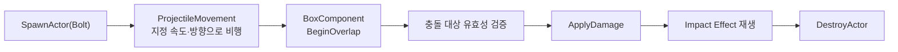

<iframe src="https://www.youtube-nocookie.com/embed/W26cxL7KbO0" title="Bullet 시스템" loading="lazy" style="width:100%;aspect-ratio:16/9;border:0;border-radius:12px" allow="accelerometer; clipboard-write; encrypted-media; gyroscope; picture-in-picture" allowfullscreen></iframe>

기본탄은 즉시 명중 판정보다 탄이 실제로 날아오는 것을 보고 피하거나 미리 조준하는 감각이 중요하다고 판단해, 히트스캔이 아닌 Actor 기반 Projectile로 구현했습니다. 탄속, Trail 표현, 충돌 판정 크기를 각각 독립적으로 조절할 수 있도록 하는 것이 설계 의도입니다.

---
## Blueprint 구성

`/Game/Developer/Bolt`를 기준으로 아래와 같은 컴포넌트 계층으로 구성했습니다.

```text
Bolt (Actor)
├─ DefaultSceneRoot            : 계층 루트
├─ StaticMeshComponent         : 탄환의 시각적 표현
├─ BoxComponent                : Overlap 기반 충돌 판정
└─ ProjectileMovementComponent : 속도와 진행 방향 제어
```

---
## 생명주기 흐름



---
## 투사체 종류

같은 생명주기를 공유하되, 발사 주체와 대상, 부가 표현만 다르게 구성한 세 가지 Blueprint를 사용합니다.

| Blueprint | 발사 주체 | 대상 | 특징 |
| --- | --- | --- | --- |
| Bolt | 플레이어 | C_EnemyBase | 기본 탄환 메시 + Impact FX |
| EnemyBolt | 적 AI | 플레이어 캐릭터 | 적 발사체 기본형 |
| EnemyBolt1 | 적 AI | 플레이어 캐릭터 | Bullet Trail Particle 추가 |

---
## 충돌 처리 원칙

- 자기 자신 및 비정상적인 대상(무효 액터 등)은 판정 초기 단계에서 제외합니다.
- 지정된 대상 타입에 해당할 때만 피해를 전달합니다.
- `DamageCauser`와 `Instigator`의 관계를 유지하여 피격 방향 계산과 처치 주체 판정에 활용합니다.
- Impact FX 실행 직후 곧바로 `DestroyActor`를 호출해 동일 대상과의 중복 Overlap을 방지합니다.
- Trail은 이동 방향과 속도를 시각적으로 읽기 쉽게 해주는 보조 표현일 뿐, 실제 충돌 판정은 항상 BoxComponent가 담당합니다.

한편 E 스나이퍼 스킬은 이 Bullet 시스템에 포함되지 않습니다. 별도의 Actor를 스폰하지 않고 `LineTraceMultiByObjectType`을 사용하는 히트스캔 방식의 무기로 분리 구현되어 있습니다. (관련: [Bullet 터널링 문제](/posts/project-ark-ts-bullet-tunneling/))

---
## 결과와 다음 단계

세 가지 투사체가 하나의 생명주기와 충돌 처리 원칙을 공유하면서도 발사 주체와 부가 표현만 다르게 재사용 가능한 구조를 갖추었습니다. Trail과 실제 판정 범위가 분리되어 있어 시각적 과장 없이 정확한 충돌을 유지하고, DamageCauser/Instigator 관계가 유지되어 피격 방향과 처치 판정이 정확하게 동작하며, Impact 직후 즉시 파괴되는 구조 덕분에 중복 피해 문제 없이 안정적으로 동작했습니다.

향후 동시에 존재하는 투사체 수가 늘어날 경우 매번 Spawn/Destroy를 반복하는 대신 Actor Pool을 적용하는 것이 성능 면에서 유리하며, 현재 Blueprint Cast로 이루어지는 충돌 대상 판별은 Gameplay Tag 또는 공통 Damageable 인터페이스로 전환하여 확장성을 높이는 방향을 고려하고 있습니다.
