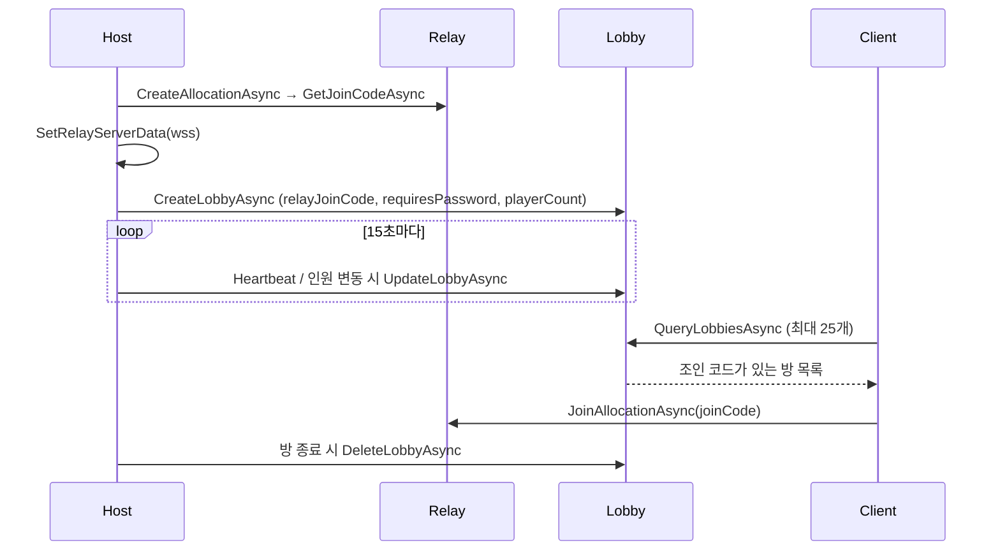

Relay는 연결, Lobby는 광고를 담당해 WebGL에서도 공개 방 목록 조회가 가능합니다.

---
## 왜 두 서비스를 같이 썼나

- <strong>Relay만 쓰면</strong>: 조인 코드를 아는 사람만 들어올 수 있어 "방 목록"이 없음
- <strong>WebGL 제약</strong>: 브라우저는 직접 UDP/IP 접속이 안 되므로 Relay를 `wss`(WebSocket) 경로로 써야 함
- <strong>해결</strong>: 실제 패킷은 Relay가 중계하고, Lobby에는 <strong>조인 코드·비밀번호 여부·인원 수만 공개 데이터로 올려</strong> 방 목록 역할만 맡김

---
## 흐름



```csharp
// Host: Relay 할당 후 조인 코드를 Lobby 공개 데이터로 광고
transport.SetRelayServerData(allocation.ToRelayServerData("wss"));
await CreateAdvertisedLobbyAsync(joinCode);

[RelayJoinCodeKey]    = new DataObject(Public, joinCode, IndexOptions.S1),
[RequiresPasswordKey] = new DataObject(Public, isPrivate ? "1" : "0", IndexOptions.S2),
[PlayerCountKey]      = new DataObject(Public, "1", IndexOptions.N1)
```

---
## 설계 포인트

- Lobby는 <strong>광고판</strong>일 뿐 게임 상태를 담지 않음 → 진실은 NGO 서버(Host)에 하나만 존재
- Lobby 데이터에 인덱스(S1/S2/N1)를 걸어 추후 비밀번호 방 필터·인원 정렬로 확장 가능
- 방장 이탈 시 Lobby 삭제 + Heartbeat 중단으로 <strong>유령 방</strong>이 목록에 남지 않도록 처리

> <strong>기여 (공동)</strong> · Relay 연결·조인 코드: 팀원 (`94ad3989`, `dda761b4`) / Lobby 공개방 등록·Heartbeat·방 목록 조회(QueryLobbies)·조인 코드 Lobby Data 공유: <strong>본인</strong> (`96de4eef`, `70c35551`)
