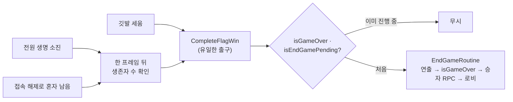

깃발 승리·최후의 1인·접속 해제가 모두 `CompleteFlagWin` 하나로 모여 승리 판정이 두 번 나지 않습니다.

---
## 문제의식

게임이 끝나는 경로가 세 갈래입니다.

1. 깃발을 세움
2. 다른 플레이어가 모두 생명을 잃음 (`NotifyPlayerEliminated`)
3. 다른 플레이어가 나가서 혼자 남음 (`OnClientDisconnectCallback`)

각 경로가 직접 승리 UI를 띄우고 씬을 넘기면, 같은 프레임에 두 경로가 겹칠 때 <strong>승자가 두 번 선언되거나 로비 복귀가 두 번</strong> 일어납니다.

---
## 구조



```csharp
// 2·3번 경로: 한 프레임 미뤄서 상태가 정리된 뒤 생존자 수를 센다
private IEnumerator CompleteLastPlayerStandingNextFrame()
{
    yield return null;
    TryCompleteLastPlayerStanding();   // 생존자 1명이면 CompleteFlagWin 호출
}

// 모든 경로의 유일한 출구
public void CompleteFlagWin(int winnerSlotIndex, Color winnerColor)
{
    if (!IsServer || isGameOver.Value || isEndGamePending) return;
    isEndGamePending = true;
    endGameRoutine = StartCoroutine(EndGameRoutine(winnerSlotIndex, winnerColor));
}
```

- `EndGameRoutine`: 연출 대기 → `isGameOver = true` → `DeclareWinnerClientRpc` → 로비 씬 로드
- `isEndGamePending`이 연출 대기 중에도 다른 경로를 막음

---
## 설계 포인트

- 종료 판정은 <strong>서버에서만</strong>, 결과는 승자 좌석(`playerSlotIndex`)과 색만 RPC로 알림
- 생존자 계산은 `ConnectedClientsList` + `IsSpectator` + `currentLives` 기준이라 나간 사람·관전자가 섞이지 않음
- 새로운 승리 조건이 생겨도 `CompleteFlagWin`만 호출하면 중복 방지가 자동으로 적용됨

> <strong>기여 (공동)</strong> · 종료 가드(`isEndGamePending`)·최후의 1인/접속 해제 판정·EndGameRoutine: <strong>본인</strong> (`3b7a2690`) / 승자 표기를 좌석 기준으로 변경: 팀원 (`b8de8fc7`)
